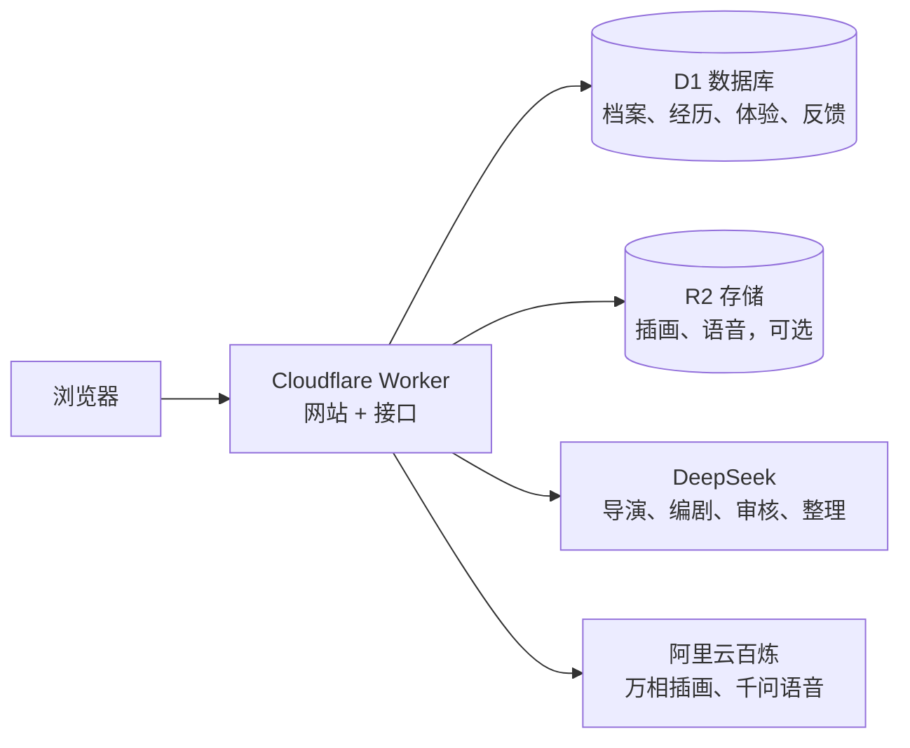

# 上线部署

网站跑在 Cloudflare Workers 上，数据库是 Cloudflare D1（SQLite），生成的插画和语音可选存进 Cloudflare R2。文字由 DeepSeek 生成，插画和语音用阿里云百炼。

## 架构



## 第一次部署

需要你自己的 Cloudflare 账号（免费版即可）。

1. 登录 Cloudflare，会打开浏览器让你授权：

   ```bash
   npx wrangler login
   ```

2. 复制配置文件并按需修改（里面不放任何密钥）：

   ```bash
   cp deploy.env.example deploy.env
   ```

3. 先试运行，看会创建什么：

   ```bash
   npm run deploy -- --dry-run
   ```

4. 正式部署。脚本会创建 D1 数据库（和 R2 存储桶，如果配置了），然后构建、上传：

   ```bash
   npm run deploy
   ```

5. 设置密钥。每条命令会让你粘贴密钥，不会显示在屏幕上，也不会进入代码仓库：

   ```bash
   npx wrangler secret put LLM_API_KEY --config dist/server/wrangler.json
   ```

   ```bash
   npx wrangler secret put DASHSCOPE_API_KEY --config dist/server/wrangler.json
   ```

数据库的表会在第一次访问接口时自动创建。

## 开通 R2（可选）

R2 用来保存生成的插画和配音。阿里云返回的链接 24 小时后失效，不开 R2 时，历史记录里超过一天的插画和配音会打不开，但不影响当次体验。

在 Cloudflare 控制台左侧找到 **R2 对象存储**，按提示开通（有免费额度，通常需要绑定付款方式）。开通后在 `deploy.env` 里保留 `R2_BUCKET_NAME`，部署脚本会自动创建存储桶。不开就删掉这一行。

## 绑定自己的域名

以 `kunkun24.com` 为例，在阿里云购买的域名：

1. **完成实名认证。** 阿里云新注册的域名在实名认证通过前处于“暂停解析”（client hold）状态，任何解析都不会生效。在阿里云“域名控制台 → 域名列表”里查看并提交认证，通常几小时到 1–3 个工作日。
2. **把域名加到 Cloudflare。** Cloudflare 控制台 → 添加域名 → 输入 `kunkun24.com` → 选免费计划。Cloudflare 会给出两个名称服务器（形如 `xxx.ns.cloudflare.com`）。
3. **在阿里云修改 DNS 服务器。** 域名控制台 → 该域名 → DNS 修改 → 换成 Cloudflare 给的两个。生效需要几分钟到 48 小时，Cloudflare 里显示“有效”即可。
4. **在 `deploy.env` 加上** `CUSTOM_DOMAIN=app.kunkun24.com`，重新运行 `npm run deploy`，部署时会自动绑定这个子域名并签发证书。

## 国内访问

`*.workers.dev` 域名在中国大陆通常打不开。需要：

1. 买一个域名（.top、.xyz 一年十几元）。
2. 在 Cloudflare 控制台添加这个域名，按提示把域名的 DNS 服务器改成 Cloudflare 的。
3. 在 Worker 的设置里添加自定义域名，例如 `mood.你的域名.top`。

域名不放在国内服务器上，所以不需要 ICP 备案，但国内访问速度会因运营商而异。如果以后要长期面向国内用户，需要迁到国内云并完成备案。

## 费用估算

以下是按 2026-11-17 查到的价格做的粗略估算，实际以各平台控制台为准。

| 项目 | 计费方式 | 每次体验大约 |
|---|---|---|
| DeepSeek `deepseek-flash`（导演 + 编剧 + 审核） | 输入 $0.15–0.30 / 百万 token，输出 $0.60–1.20 / 百万 token，非高峰时段半价 | 约 1 万多 token，**不到 0.1 元**；审核不通过要重写时约翻倍 |
| 万相插画（默认每次 1 张） | 按成功生成的张数计费 | 旧版万相 V1 为 0.16 元/张；当前模型的单价没查到，按 **0.1–0.3 元** 估 |
| 千问语音合成（仅音频故事） | 按字符计费 | 单价未查到，一段几百字的故事估计 **几分钱** |
| Cloudflare Workers / D1 / R2 | 免费额度：Workers 每天 10 万次请求，D1 5 GB，R2 10 GB | 课堂规模基本 **0 元** |

按每次体验 0.1–0.4 元算，50 个同学每人用 5 次，大约 25–100 元。省钱方法：

- 把 `IMAGES_PER_SESSION` 设为 0，只用文字和浏览器朗读。
- 审核员也用 `deepseek-flash`，不单独换成 `deepseek-v4-pro`。
- 新用户在阿里云百炼通常有免费额度，以控制台为准。

**实时语音对话（还没接入）**：千问 Omni Flash 的官方原价是输入音频 18 元/百万 token、输出 72 元/百万 token（非实时版价格，实时版需在控制台确认）。按每秒约 25 个音频 token 粗算，5 分钟的对话大约 0.3–0.5 元。这个估算的换算比例没有核实。

## 本地用真实服务测试

```bash
cp .dev.vars.example .dev.vars
```

在 `.dev.vars` 里填上 `LLM_API_KEY`（和可选的 `DASHSCOPE_API_KEY`），然后照常 `npm run build` 和 `npm start`。

## 更新和回滚

- 改完代码后再运行 `npm run deploy` 即可，数据库和密钥会保留。
- 回滚到上一个版本：`npx wrangler rollback --config dist/server/wrangler.json`。
- 查看线上日志：`npx wrangler tail --config dist/server/wrangler.json`。
