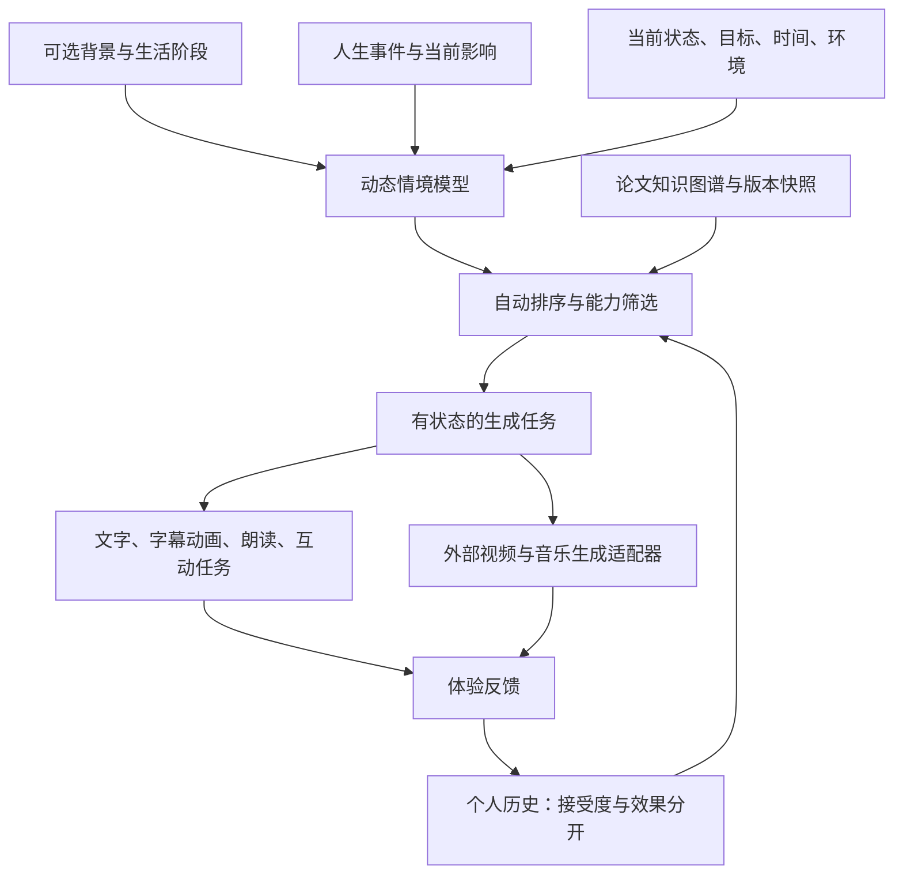

# Mood Capsule：自动选择体验的网站框架

2026-11-17。本阶段为本地课堂项目，重点是可运行的核心流程。系统选择媒介，用户只描述目标、时间和当下条件。背景可选填写，不要求用户指定故事或视频。

## 模块与数据流



实现位置：`web/core` 为选择与生成逻辑，`web/db` 为持久化，`web/app/api` 为接口，`web/app` 为简易操作界面，`web/generated/kb.json` 为固定的知识库快照。没有把个人数据写回公共知识库。

## 当前可以运行的部分

- 浏览器独立档案、背景修改、经历新增/重新确认/删除、全部数据导出与删除。
- 自动选择短阅读、互动故事、字幕动画、音频故事、互动小任务等候选；视频和音乐需生成服务可用，真人匹配尚未启用。
- 默认使用明确标注的本地示例内容，跑通选择、生成、播放、结束、反馈。示例文本不是大模型随机生成，也不证明个性化内容有效。
- 配置模型后调用兼容 Chat Completions 的 JSON 生成接口；检查结构、时长、禁止话题和选项后果。文本错误不会偷偷回退为“AI 已完成”。
- 外部音视频适配器区分排队、制作中和可播放资产；支持查询制作状态。字幕动画、朗读和分镜不称为真实生成视频。
- 每次记录政策版本、知识库版本与 SHA-256、背景修订号、候选评分及排除理由。修改背景后，旧的待生成任务需要重新安排。
- 生成任务有抢占锁、90 秒租约、最多三次尝试、取消与重复请求保护；同一次反馈只进入学习一次。

## 经历怎样随时间和年龄调整

当前权重用于估计内容相关性和阅读/互动负担，**不表示创伤程度、疾病风险或某个事件的因果效应**。

实现公式见 `web/core/engine.ts`，参数集中在 `web/core/catalog.ts`：

`相关性 = (0.4 × 当前影响 + 0.3 × max(重要性, 中心性) + 0.3 × max(近期性, 0.9 × 中心性)) × 确认新鲜度 × 年龄距离因子 × 生活阶段因子`

- 近期性按事件类型的半衰期衰减（日常压力 30 天、成就 90 天、身份或环境变化 180 天、关系变化 365 天、失去与健康 730 天、其他 90 天），依据是人对不同事件的适应速度不同（Lucas 2007）；持续事件使用最近确认时间作为锚点。
- 中心性来自“这件事在多大程度上已成为我看待自己的一部分”（借用事件中心性的思路，Berntsen & Rubin 2006）。中心性高的经历不会只因时间久远而失去相关性。
- 确认新鲜度按 180 天半衰期衰减。很久以前发生的事件，在用户重新确认它仍然重要后可以重新获得较高相关性。
- 年龄只改变事件相对于已度过人生的时间距离，调整范围为 0.75–1；没有“年轻人看视频、年长者读故事”的规则。
- 生活阶段不匹配时乘 0.8；未知时不惩罚。新事件的当前负担可以提高本次情境负担，从而降低高阅读量和高互动量内容的排名。
- 所有数值都是**版本化工程初值**，不是论文提供的通用心理学系数，应通过课堂数据和后续研究调整。
- “用于选择”与“允许作为内容素材”分开授权；只有同时满足两项的相关经历才可能进入生成上下文。

这实现了可追踪、可重算的动态模型，还不是从长期纵向数据训练出的心理预测模型。事件的当前影响与精力负担目前由用户简短确认，尚未实现从自由文本可靠自动推断这些量。

## 系统怎样自动选形式

首先排除时间不足、声音/屏幕条件不符、设备不支持、生成服务未连接的候选。然后分别计算目标匹配、当前负担、媒介习惯、个人效果经验、接受度和重复程度。

初始排序权重分别是 0.34、0.22、0.12、0.25、0.04、0.03；均为工程假设。个人效果使用同目标、相近负担下的历史反馈，旧反馈按 60 天半衰期衰减，并用五次中性先验降低小样本过拟合。

个人效果按相对值计算：每种体验的结果减去此人同一目标下所有体验的平均结果。用户多在状态差时来用，下次测量本来就会回升（回归均值），这部分对所有体验相同，相减后抵消。只有一种体验有数据时，系统不会因此认为它“有效”。

在此基础上还有两项调整，都会写进“为什么这样安排”：

- **回避平衡**：近 14 天最近 6 次体验中至少 5 次、且 80% 以上是分心类时，非分心类体验加 0.08 分。当前紧张程度 ≥8 时不调整。
- **筛查提示**：最近 14 天内 PHQ-4 任一分量表 ≥3 时，刺激度高于 0.5 的体验减 0.1 分，并展示求助资源。

“喜欢”“完播”和“观看时间”不当作情绪改善。平静目标比较紧张程度，鼓励目标比较希望感，成就目标比较掌控感，并结合目标达成感；不适反馈单独降低结果。没有前后状态时，不生成虚构的效果分。

## 产出范围

| 候选 | 本地现状 | 接下来需要的工作 |
|---|---|---|
| 短阅读、互动故事 | 可播放示例；可接模型生成 | 扩充结构、检验分支一致性 |
| 短幽默、安静字幕动画 | 浏览器动效与字幕分段播放 | 更完整的视觉、配音与素材制作 |
| 音频故事 | 浏览器可用时朗读脚本 | 真实 TTS 音频文件、声线与时长校验 |
| 互动小任务 | 选择后显示不同结果 | 更丰富的游戏规则和状态 |
| 完整短视频、音乐 | 服务适配接口和任务状态已实现 | 接入并实测具体生成商 |
| 真人短聊 | 候选和知识依据保留，能力关闭 | 匹配队列、会话和聊天服务未实现 |

## 知识库与研究依据

当前为 81 个节点。新增的媒介研究、样本、适用边界和出处见 [自动选择媒介的研究说明](adaptive-media-evidence.md)。短片可能有用不等于无限刷流有用；四分钟喜剧实验不能直接证明突然插播三十秒冷笑话有效。

产品反馈只是观察记录，不自动升级为知识库证据。社区贡献目前沿用仓库提交、人工审核和版本发布流程，尚未建设网页投稿与审稿后台。

## 完整度边界与验证

框架已包含数据、决策、生成任务、体验、反馈和证据追溯的纵向流程。外部模型和媒体真实效果、跨设备账户、真人匹配、网页审稿后台、大规模使用和长期效果研究尚未完成；不能把“框架可运行”写成“完整商业产品已上线”。

本地测试覆盖日期与授权、年龄不直接决定媒介、事件衰减与重新确认、环境限制、个人反馈学习、知识引用存在性、输入校验、用户隔离、重复请求、反馈去重、任务取消与失败重试。实际外部生成商需在配置后另行测试。

## 安全与研究设计

知识库中的 `risk` 节点对应以下实现，状态见 [INDEX.md](../INDEX.md) 的风险清单：

| 风险 | 代码中的处理 | 局限 |
|---|---|---|
| 使用中出现危机 | 可选 PHQ-4；危机用语检测后不创建体验并展示 12356、110/120；不保存触发原文 | 只是关键词检测；PHQ-4 中文措辞未经验证 |
| 经历影响统一衰减 | 按事件类型的半衰期；中心性高的经历保留相关性 | 半衰期是工程初值 |
| 过度依赖分心 | 回避平衡加分，高紧张时不调整 | 只看整体比例，没有长期随访 |
| 前后测偏差 | 研究模式三组随机；中性组不参与学习；个人学习用相对值；反馈措辞中性 | 组间统计分析需在导出数据上另做；日常模式的一键反馈是粗略映射 |
| 鼓励适得其反 | 生成后检查直接评价用户的说法；“被说教”反馈压低学习分 | 固定说法检查 |
| “必须开心”的压力 | 生成内容和界面文案都检查承诺性说法 | 固定说法检查 |
| 跨文化外推 | 不在代码中：产品没有用 ERQ 抑制分做任何解读 | 这是研究解读层面的规则 |

## 交互设计：尽量少做选择

- **此刻**：点一张心情卡片就开始。每张卡片对应一个目标和一组粗略的起始状态（例如“紧绷，静不下来”对应“平静下来”、紧张 8/10）。体验结束后点“好一些了 / 差不多 / 更难受了”之一，系统换算成前后变化（好一些 = 目标指标改善 3 分）。这种换算很粗，所以研究模式下改回滑块。
- **关于我**：用户随便写，信息整理 agent 整理成可删改的卡片，确认后才保存。经历默认只用来安排形式，要写进故事需要用户逐条打开。

## 三维小店如何承载系统的安排

| 系统选择 | 店里的呈现 |
|---|---|
| 安静探索动画、短幽默动画、短视频 | 柜台左边的小电视亮起，屏幕显示标题 |
| 音频故事、音乐 | 柜台右边的收音机亮灯、轻微震动 |
| 互动故事、小任务 | 柜台上的“留给此刻的你”卡片 |
| 等待生成 | 兔兔在柜台后来回小跳，像在货架上找东西 |
| 结束 | 把杯子放下，即一键反馈 |

镜头会在安排确定后转向对应物件，结束后回到兔兔。三维场景只负责呈现，选择逻辑仍在 `web/core/engine.ts`。代码位置：`web/app/shop-world-engine.ts`（场景、角色、镜头）、`web/app/immersive-shop.tsx`（React 接入和失败回退）。

## 三维场景的结构（第一人称版）

| 文件 | 负责 |
|---|---|
| `web/app/shop-world-engine.ts` | 场景搭建、灯光和后期、Rapier 物理、第一人称控制、自动行走、交互和设备高亮 |
| `web/app/world/assets.ts` | 加载压缩后的模型、贴图、夜景全景图，以及 Blender 烘焙的外壳和光照贴图 |
| `web/app/world/layout.json` | 道具、灯光和尺寸的共享布局；网页引擎和 Blender 烘焙脚本读同一份 |
| `web/blender/build_shop.py` | 用 Blender 搭建店铺和街道外壳、烘焙间接光照、导出 glTF |
| `web/app/world/rabbit.ts` | 兔子的毛发材质和行为（柜台上走动、吃草、理毛、下柜台去厕所、被摸时蹦跳） |
| `web/blender/build_rabbit.py` | 用 Blender 生成兔子模型（`public/assets/rabbit/rabbit.glb`） |
| `web/app/world/audio.ts` | 程序合成的雨声、门铃、脚步、收音机杂音 |
| `web/app/immersive-shop.tsx` | 加载进度、准星和提示、手机摇杆与互动按钮 |

访客进出店铺由角色位置判断；页面上的“推门进去”和“到街上走走”会让角色自动走过去。系统选择体验后，角色会走到对应物件前并看着它，访客任何时候都可以自己移动来打断。加 `?debug` 打开页面时，`window.__shop.debug()` 返回角色位置和可推动物件的位置，用于自动检查。

### 静态外壳的烘焙流程

墙、地面、柜台、雨棚、街道和对面楼房在 Blender 里搭建，用 Cycles 把间接光（灯光在墙面、地板之间的反弹）烘焙成两张光照贴图：`lm_shop.webp`（店铺）和 `lm_street.webp`（街道）。网页里只实时计算直射光和阴影，反弹光直接读贴图，所以既有真实的光线层次又不增加手机负担。

在 `web/` 目录运行（需要安装 Blender 4.2 以上，约 2–3 分钟）：

```bash
"/c/Program Files (x86)/Steam/steamapps/common/Blender/blender.exe" -b --factory-startup -P blender/build_shop.py -- --assets assets-src/polyhaven --out public/assets/shop --samples 1024 --size 2048
```

约定：

- 外壳的材质名是 `表面@分组`（如 `brick@shop`、`asphalt@street`），引擎按表面换上真实贴图，按分组选光照贴图。
- 名字以 `COL_` 开头的方块是碰撞体，引擎读取后生成 Rapier 静态碰撞，不渲染。
- 改动道具或灯光位置时只改 `layout.json`，再重新烘焙一次，网页和烘焙结果保持一致。
- 门、玻璃、招牌、电视屏幕、兔兔和可推动的物件不烘焙，仍由引擎实时创建。

### 店里的物件

| 物件 | 平时 | 系统安排了内容时 |
|---|---|---|
| 电视 | 点一下换台：雨夜画面、4-2-6 呼吸引导、关 | 屏幕显示标题，点开播放 |
| 收音机 | 点一下播放程序生成的轻音乐 | 点开收听音频内容 |
| 闹钟小屏 | 显示真实时间；点一下安静计时 3 分钟，结束时轻响三声 | — |
| 柜台便签 | 给下次来的自己留一句，只存在本机浏览器 | 显示今晚的小练习，点开开始 |
| 草篮、厕所 | 兔子吃草、上厕所的地方 | — |

兔子模型的生成命令（在 `web/` 目录）：

```bash
"/c/Program Files (x86)/Steam/steamapps/common/Blender/blender.exe" -b --factory-startup -P blender/build_rabbit.py -- --out public/assets/rabbit/rabbit.glb
```

兔子模型不做 meshopt 压缩：压缩时的顶点量化会改动部件的旋转支点，也会改变毛发的疏密。
